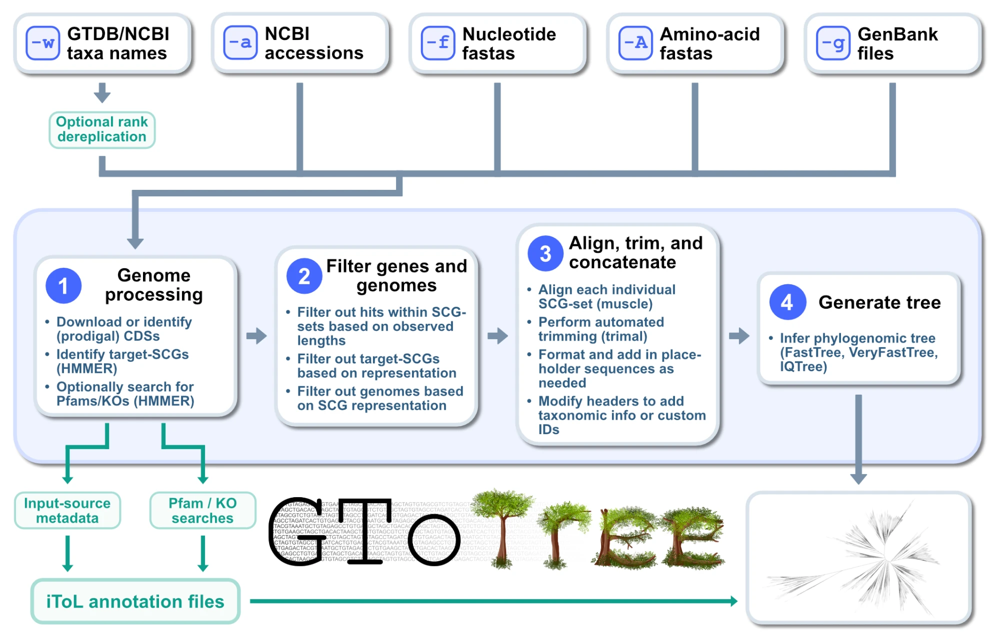

<p align="center">
<a href="https://astrobiomike.org/gtotree/"></a>
</p>

<p align="center">
<a href="https://doi.org/10.1093/bioinformatics/btz188"></a>
<a href="https://scholar.google.com/citations?view_op=view_citation&citation_for_view=-ONw6lsAAAAJ:_FxGoFyzp5QC"></a>
<a href="https://astrobiomike.org/gtotree/installation/#conda-quickstart"></a>
<a href="https://astrobiomike.org/gtotree/"></a>
</p>

---

# GToTree: a user-friendly workflow for phylogenomics

GToTree is a user-friendly workflow for phylogenomics intended to give more researchers the capability to create phylogenomic trees, and to make the process of iterating on them much easier. **Documentation and examples live at [astrobiomike.org/gtotree](https://astrobiomike.org/gtotree/)**, and the open-access Bioinformatics Journal publication is available [here](https://doi.org/10.1093/bioinformatics/btz188). GToTree can be installed and run on a Mac or Linux machine, as well as on Windows within a Windows Subsystem for Linux environment 👍

For an overview of what this is all about, see the [What is GToTree?](docs/what-is-gtotree.md) page. Or, to see some practical ways GToTree can be helpful, scan through the [Example usage](docs/example-usage.md) page.

---

**A quick [conda installation](docs/installation.md#conda-quickstart) can be run like so:**

```bash
conda create -y -n gtotree -c astrobiomike -c conda-forge -c bioconda gtotree
```

**And making a phylogenomic tree can be as easy as naming the group you want:**

```bash
gtotree -w Nitrospirota --add-gtdb-tax
```

---

<a href="docs/images/GToTree-overview.webp"></a>

GToTree takes genomes from any combination of a taxon name (`-w`), NCBI accessions (`-a`), nucleotide (`-f`) or amino-acid (`-A`) fasta files, and GenBank files (`-g`); finds the target single-copy genes in each; filters genes and genomes; aligns, trims, and concatenates; and produces a phylogenomic tree, along with iToL-compatible annotation files for the input sources and any additional genes searched for.

---

## Documentation

* [**What is GToTree?**](docs/what-is-gtotree.md)
* [**Installation**](docs/installation.md)
* [**Example usage**](docs/example-usage.md)
* [**User guide**](docs/user-guide.md)
* [**Single-copy gene-sets**](docs/scg-sets.md)
* [**Things to consider**](docs/things-to-consider.md)
* [**Changelog**](CHANGELOG.md)

Running `gtotree -h` gives the condensed help menu, `gtotree -s` the detailed one, and `gtt` by itself an overview of all the helper subcommands.

---

## Citation information

GToTree relies on many great programs. Along with all other outputs, it will generate a `citations.txt` file with citation information specific for every run that accounts for all programs it relies upon. Please be sure to cite the developers appropriately :)

Here is an example output `citations.txt` file from a run, and how I'd cite it in the methods:

```
GToTree v2.0.0
Lee MD. GToTree: a user-friendly workflow for phylogenomics. Bioinformatics. 2019; (March):1-3. doi:10.1093/bioinformatics/btz188

Genome Taxonomy Database (GTDB)
Parks DH et al. A complete domain-to-species taxonomy for Bacteria and Archaea. Nat. Biotech. 2020. doi.org/10.1038/s41587-020-0501-8

Prodigal v2.6.3 (via pyrodigal v3.6.3)
Hyatt, D. et al. Prodigal: prokaryotic gene recognition and translation initiation site identification. BMC Bioinformatics. 2010; 11, 119. doi.org/10.1186/1471-2105-11-119
Larralde, M. Pyrodigal: Python bindings and interface to Prodigal, an efficient method for gene prediction in prokaryotes. J. Open Source Softw. 2022; 7(72), 4296. doi.org/10.21105/joss.04296

HMMER3 v3.4 (via pyhmmer v0.11.1)
Eddy SR. Accelerated profile HMM searches. PLoS Comput. Biol. 2011; (7)10. doi.org/10.1371/journal.pcbi.1002195
Larralde, M., et al. PyHMMER: a Python library binding to HMMER for efficient profile hidden Markov model search. Bioinformatics. 2023. doi.org/10.1093/bioinformatics/btad214

Muscle v5.3
Edgar RC. MUSCLE v5 enables improved estimates of phylogenetic tree confidence by ensemble bootstrapping. bioRxiv. 2021.06.20.449169. doi.org/10.1101/2021.06.20.449169

TrimAl v1.5.0
Gutierrez SC. et al. TrimAl: a Tool for automatic alignment trimming. Bioinformatics. 2009; 25, 1972-1973. doi.org/10.1093/bioinformatics/btp348

VeryFastTree v4.0.5
Pineiro C et al. VeryFastTree: speeding up the estimation of phylogenies for large alignments through parallelization and vectorization strategies. Bioinformatics. 2020. doi.org/10.1093/bioinformatics/btaa582
```

**Example methods text based on above citation output (be sure to modify as appropriate for your run)**
> *The phylogenomic tree was produced with GToTree v2.0.0 (Lee 2019), using the prepackaged single-copy gene-set for Nitrospirota. Briefly, reference genomes were selected by GTDB taxonomy (Parks et al. 2020), Prodigal v2.6.3 (Hyatt et al. 2010) was used to predict genes on input genomes provided as nucleotide fasta files, and target genes were identified with HMMER3 v3.4 (Eddy 2011), individually aligned with MUSCLE v5.3 (Edgar 2021), trimmed with trimAl v1.5.0 (Capella-Gutiérrez et al. 2009), and concatenated prior to phylogenetic estimation with VeryFastTree v4.0.5 (Piñeiro et al. 2020).*
