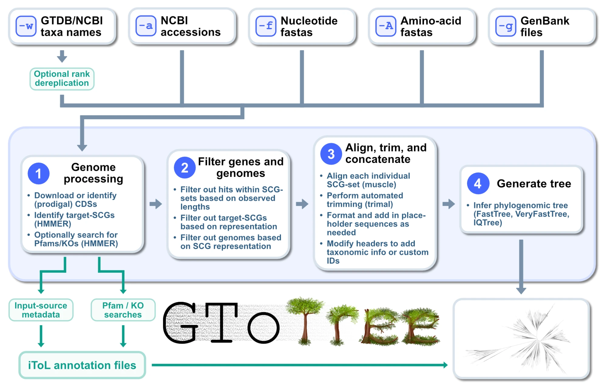

# What is GToTree?

<a href="images/GToTree-overview.webp"></a>

Phylogenomics is the practice of trying to infer evolutionary relationships at something closer to the genome-level than individual-gene trees (see [this page](https://astrobiomike.github.io/genomics/phylogenomics#concepts) if wanting a little more on this, or [this video](https://merenlab.org/2020/06/27/seminar-series-on-microbial-omics/#august-12-2020) for a bit on phylogenetics vs phylogenomics). It is becoming an increasingly essential step in many biologists' work.

GToTree is a program that aims to give more researchers the capability to generate phylogenomic trees to help guide their work. At its heart it just takes in genomes and outputs an alignment and phylogenomic tree based on the specified [single-copy gene-set](scg-sets.md). But I think a large part of its value comes from:

1. **its flexibility with regard to input**, taking a taxon name (so it gathers the reference genomes for us), NCBI accessions, nucleotide or amino-acid fasta files, and/or GenBank files, in any combination, and retrieving and handling each individual reference genome for us rather than us having to find and download each one ourselves
2. **its automation of the required between-tool tasks**, such as filtering hits by gene-length, filtering out genomes with too few hits to the target genes, aligning and trimming all targets individually before concatenating them together, and swapping genome labels for something more useful (i.e. lineage info at desired ranks rather than just accessions, and/or appending identifiers of characteristics we care about) so we can more easily navigate and explore the final alignment and tree
3. **its scalability**, making iterating on phylogenomic trees a cinch rather than a project

GToTree also comes packaged with [46 single-copy gene-sets](scg-sets.md) suitable for phylogenomic analysis of different major taxa, and can [build a new one](scg-sets.md#building-your-own) for any group of genomes you give it.

> **The open-access Bioinformatics Journal publication is available [here](https://doi.org/10.1093/bioinformatics/btz188).**

---

**A quick [conda installation](installation.md#conda-quickstart) can be run like so:**

```bash
conda create -y -n gtotree -c astrobiomike -c conda-forge -c bioconda gtotree
```

**And making a phylogenomic tree can be as easy as naming the group you want:**

```bash
gtotree -w Nitrospirota --add-gtdb-tax
```

---

## Overview

The figure above is an overview of the processing GToTree does, with more detail below. For practical ways GToTree can be helpful, check out the [Example usage page](example-usage.md). And for detailed information on using GToTree, see the [User guide](user-guide.md).

### Input genomes

Any combination of the following, with each genome's sequences retrieved and prepared for us:

* **A taxon name (`-w`)**: new in v2, GToTree pulls the reference genomes for a taxon at any rank (e.g. `-w Bacteria`, `-w Nitrospirota`, `-w "Escherichia coli"`) from [GTDB](https://gtdb.ecogenomic.org/) or NCBI, optionally dereplicated down to one genome per rank so broad trees stay a manageable size
* **NCBI assembly accessions (`-a`)**: downloads the amino-acid sequences of the annotated coding sequences (CDSs) if available, otherwise downloads the assembly and calls genes
* **Nucleotide fasta files (`-f`)**: CDSs are identified with [Prodigal](https://github.com/hyattpd/Prodigal) (via [pyrodigal](https://github.com/althonos/pyrodigal))
* **Amino-acid fasta files (`-A`)**: used as they are
* **GenBank files (`-g`)**: CDSs are extracted if annotated, otherwise they are identified with Prodigal

### Identify target genes

* GToTree searches each genome for the target genes of the specified single-copy gene-set with HMMER3 (via [pyhmmer](https://pyhmmer.readthedocs.io/)), using each profile's own gathering cutoff
* 46 SCG-sets are packaged with the software, listed on the [SCG-sets page](scg-sets.md) and by running `gtt hmms`, and one is picked automatically when `-w` is used without `-H`
* a table of hits per target-gene per genome is written out (`SCG-hit-counts.tsv`)

### Optionally identify additional target genes of interest

* GToTree can also search each genome for any additional genes of interest based on [Pfam](https://www.ebi.ac.uk/interpro/entry/pfam/) accessions (`-p`) or [KO](https://www.genome.jp/kegg/ko.html) accessions (`-K`, utilizing [KOFamScan](https://github.com/takaram/kofam_scan)), and produces [Interactive Tree of Life](https://itol.embl.de/)-compatible annotation files for easy visualization (see the [example here](example-usage.md#visualization-of-gene-presenceabsence-across-the-bacterial-domain))
* an iToL annotation file marking each genome's input source is also produced automatically, so e.g. your own MAGs are easy to highlight among the references

### Filter genes and genomes

* filter out gene hits based on length: get the median of all genes in that set, and drop those whose length is not within a certain range of it (20% by default, `-c`)
* filter out target genes that are found in too few of the genomes (`-r`)
* filter out genomes that do not have hits to at least a certain fraction of the target genes (50% by default, `-G`)

### Align, trim, and concatenate

* align each gene-set with [MUSCLE](https://www.drive5.com/muscle/)
* perform automated trimming with [trimAl](http://trimal.cgenomics.org/)
* add the appropriate-sized gap-sequences for target genes that are missing from genomes being retained
* concatenate everything into the full alignment, along with partition files for programs that can use per-gene models

### Modify the labels

* add either NCBI (`-t`) or GTDB (`-D`) taxonomic information to the labels that will be displayed on the tree
* and/or provide a mapping file (`-m`) with the desired label and/or text to append for any of the input genomes

### Tree

* tree with [FastTree 2](http://www.microbesonline.org/fasttree/), [VeryFastTree](https://github.com/citiususc/veryfasttree) (the default), or [IQ-TREE](http://www.iqtree.org/)

### Outputs

Primary outputs include:

* the tree and alignment files
* a genome summary table mapping all modified labels to original genome IDs, with any available taxonomy information
* a table of the number of hits per single-copy gene per genome, and tables for any additional genes searched
* one table of every input genome that didn't make it into the tree, and at what stage and why
* iToL annotation files for the input sources and any additional target genes
* a [citations file](user-guide.md#citation-information) with citation information specific to the run for all the programs GToTree utilized, to help with proper citation 👍

Runs can be [resumed](user-guide.md#resuming-an-interrupted-run) if interrupted, and all of the helper programs are subcommands of **`gtt`** (run `gtt` by itself for an overview).
